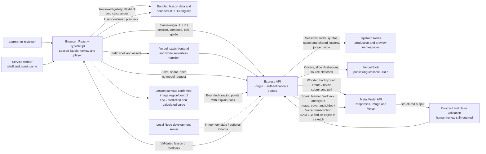

# ExplainBack architecture and technology stack

This document describes the standalone `explainbackapp` repository. Update the diagram and stack table in the same change whenever components, integrations, storage, deployment paths, or model responsibilities change. Verify the implementation and deployment independently; this diagram is not a release-status record.

## Creation and learning flow

1. A reviewer enters via an access code or tester session. Public gallery lessons can play without sign-in or a model request.
2. The author explicitly asks for a lesson. In hosted Studio, Wonder can submit a background response; the browser polls the API while the page remains open. Spark handles learner feedback and the test-learner role. In a tryout the learner's chapter transfer answers are checked by code; a blank or whitespace-only transfer answer makes the tryout report malformed, so it is rejected rather than graded as a choice or as zero. Other configured choices and synchronous paths remain available locally.
3. The server validates structured lesson data, including obvious question-shaped generated prediction claims, before returning it. The author reviews and can revise the assumptions, formulas and teaching text before presentation. Validation does not establish scientific correctness or guarantee that a statement is meaningful or testable.
4. The browser runs bounded model or process demonstrations and checks numeric transfers locally. Numeric answer fields derive a conservative rounding hint from the existing tolerance in the displayed unit, checking that the rounded value survives conversion back to authored units. Exact or unrepresentable increments ask for the full calculated value; precision-losing conversions offer a return to authored units. Unit switches clear the numeric entry/result. This guidance does not change marking tolerances. Optional model feedback is a separate explicit request; the generated equations and authored explanations still need human review.
5. Background requests and responses, including attached images, are stored by Meta. The app stores temporary session state in Redis in the cloud; it does not resume background work after a page reload or navigation. Browser speech synthesis plays show narration; optional Meta Image draws show covers and, on request, one illustration per slide; optional Meta Voice transcribes the spoken explain-back. With Vercel Blob configured, drawn images and source sketches are stored as public, unguessable URLs and kept with saved lessons.
6. Every numeric model lesson offers a prediction canvas, independently of image metadata. The Library's **Try the canvas** link opens the public pendulum sketch lesson without sign-in or a model request. The learner can draw a predicted curve with a pointer or enter three points, reveal the existing model calculation, and explicitly submit their explanation and prediction together for authenticated feedback. Source images appear beside the controls. For an image-based numeric lesson, the creator can also select a SAM suggestion, draw a region, or select the whole image with the keyboard, then explicitly connect it to an existing control. This optional chapter metadata requires renewed lesson review and stays with saved/exported/shared lessons. It does not infer physical measurements from image pixels. Process explorers and catalog simulations keep their existing players. [Lesson canvas](lesson-canvas.md) describes the boundaries and recovery behavior.

The public evaluation card is built from `docs/evaluation.md` and documents methods and limits. Dated evaluation reports and operational measurements are kept in the separate private repository and are not linked from the public app. Selected lesson fixtures remain public and reviewable.

The author, grounding, explain-back guide and test-learner (tryout) response schemas
carry the same text-length and collection bounds as their readers
(`public/schema-text.mjs`, `public/lesson-schema.mjs`, `public/demo-model.mjs`,
`src/lesson-ground.mjs`, `src/lesson-author.mjs`, `src/lesson-tester.mjs`). The tryout
schema also fixes its chapter array to the lesson's chapter count for each request,
and the prompts keep shorter text targets than the reader limits. These constraints
are sent in the structured response format; local validation remains authoritative
and does not trim overlong content into an acceptable response. Grounding errors
identify the fact and field without echoing rejected values.

Numeric models are checked over continuous input/axis intervals. When a coarse interval
cannot establish a valid domain, the checker subdivides the input box and recomputes all
outputs in dependency order on each child. Both children include their shared boundary.
Every child must pass; an unresolved box or the work/depth limit rejects the model. This
avoids some false singularities from correlated terms (such as positive damping in an
oscillator) without sampling, changing the equations, or accepting an actual zero
denominator. It remains a conservative arithmetic check, not scientific validation.

## Create and Tryout workspace

The creator workspace separates navigation from the working lesson and its learner attempt. A persistent lesson header exposes Create / Tryout tabs, Create home, New lesson, and saving. Global Create explicitly opens the home form and its current-work resume card. Returning home does not clear the draft; starting or opening another lesson protects unsaved changes with save, discard and keep-editing choices. Failed saves or generation leave the current work intact. A successful new draft clears the prior saved ID so it cannot overwrite that lesson.

The editor and creator's player remain mounted while hidden. The player pauses animation, guided replay and microphone capture when hidden; switching areas sends no model or transcription request. The browser recovery record under `explainback-studio-draft` retains navigation, the original attempt lesson and engine state, transfer input/result, explanations, drawings, cached feedback, pending definition edits, and a saved-content fingerprint. Save and navigation changes persist immediately; typing is debounced and page exit flushes the latest record. Optional fields extend the version-1 record; legacy `presenting` migrates to the corresponding area. The saved lesson's server identity remains separate from local recovery, and a failed local write displays a save/export notice.

Recovery is bound to the current browser login through a non-authorizing `recoveryScope` returned by the auth and login routes. It is derived separately from the server-side login identity and cannot authenticate API requests. The browser stores this scope with the draft and a separate active-scope marker. Refreshing or reopening a tab during that login preserves the attempt. Sign-out, known expiry and a different login invalidate recovery; storage events hide private work in other tabs, and stale unmount/debounced writes cannot restore an invalidated record. A late initial auth response cannot replace another tab's newer scope; initialization retries against the current session when the marker changes while the request is pending. Legacy records without a login binding are not restored automatically. Signing in again starts a new recovery scope; server-saved lessons remain available through their normal permissions.

Saved-lesson updates compare the exact snapshot read before image work with the current stored record. The memory adapter and Redis Lua write reject a changed or deleted snapshot atomically, so a pending save cannot undo unsharing or recreate a deleted lesson. Share changes and saved-cover updates use the same comparison. Conflicts return 409 and preserve the browser draft; only images uploaded by the refused save are removed. Existing image references are not treated as new uploads. Saved explain-back feedback accepts the guide reader's full 1000-character limit; the learner's own explanation remains limited to 700 characters.

Changes to learner-facing content invalidate review and mark the prior attempt outdated. It remains available in recovery until the creator explicitly starts a new tryout after review. Title and display-unit changes preserve the attempt. Unapplied definition edits block save and tryout until applied or discarded. In-flight requests remain associated with their current working lesson; choosing to stop before moving on invalidates late replies. Ordinary area switching keeps the request active, with editors disabled during mutations. Public gallery and shared lessons retain their standalone player and existing access rules.

A model revision carries a creator-confirmed image/control connection only when the entire numeric demo has one exact match in each lesson. Canonical JSON comparison ignores object-key order, while matching independently of chapter position permits unambiguous reordering. Changed or ambiguous demos lose confirmation; a revision notice reports removals and the bilingual diff describes connection additions, removals and edits. Model-supplied connection fields cannot replace the creator's confirmation. Source-image retention, earlier learner attempts and renewed review continue through the existing workspace flow.

Shared-link reading starts a new personal learner attempt for every reader, including an owner or administrator. The public shared response contains the lesson, source image and show, but excludes the creator's saved tryout and explain-back grades. Explicit authoring through the authenticated owner or administrator shelf or edit route restores those results; ownership/management permission alone does not identify a continuation of the creator's attempt. Stored results are unchanged.

The public shared index returns up to 48 summaries with a nullable offset cursor. Redis determines whether another page exists from the indexed positions it scanned, even if a lesson disappears or becomes private before its record is fetched; such records are omitted without prematurely ending the listing. The catalog fetches these pages until complete, deduplicates IDs, reports loading or failure with retry, and applies search, filters and the selected sort to the combined index before showing 9, 18 or 36 cards per page (default 9). It sorts localized titles with the selected language's collation, or the recorded creation/update timestamps of shared records; undated built-in entries follow dated records in either direction. Update timestamps can reflect sharing and cover changes. The client restarts its load after share changes; concurrent updates during pagination can shift offsets, so a refresh may be needed for a consistent view. Owner and administrator annotations remain derived per request; lesson content and owner IDs are not included in summaries.

Saved records carry separate client-reported `lessonModel` and `showModel` labels for the latest lesson generation or revision and the show script, respectively; subsequent manual edits are possible. The lesson label also travels with browser recovery and is restored when undoing a revision. The older `model` field is retained for compatibility but cannot establish either role. Older records show its value only as role unknown, and a show without its own label has an unknown narration source. Old browser recovery snapshots also lose their cached show-model label because it may have come from that ambiguous field. When an older client omits the new fields on update, the server retains each known label only if its corresponding validated content is unchanged; it otherwise clears that label. These labels are creator-supplied metadata, not independent verification of authorship or scientific accuracy.

## Technology stack

| Layer | Technology and role | Source of truth |
| --- | --- | --- |
| Client | React 19, TypeScript, Vite; bilingual English / Simplified Chinese interface | `frontend/`, `package.json` |
| Appearance | Paper, Liquid Glass and Meta Blue with light/dark palettes; independent System (default), Light and Dark modes; semantic CSS colors and a bilingual preview-tile picker; browser-local preferences | `public/appearance.js`, `public/themes.css`, `frontend/appearance.css`, `frontend/components/Appearance.tsx` |
| Simulations and graphics | Plain ES modules, D3 scale/shape/selection; bounded expressions and predefined engines | `public/`, `frontend/components/ExperimentView.tsx` |
| Lesson canvas | SVG and Pointer Events; prediction drawing and keyboard point entry in every numeric model lesson, optional creator-confirmed image regions/control links, prediction overlay, shared bounded drawing validation and server-recomputed comparison values | `frontend/components/CanvasBindingEditor.tsx`, `frontend/components/PredictionCanvas.tsx`, `public/lesson-canvas.mjs` |
| Server | Node.js 26, Express 5; shared local and Vercel API handler | `src/server.mjs`, `api/index.js` |
| AI | Meta Muse Wonder, Spark, Image, Voice and SAM 3.1; OpenAI-compatible Responses SDK for text, direct Meta APIs for image, audio and segmentation; Muse Glimmer or a Muse Spark Open build through Ollama locally | `src/meta.mjs`, `src/llm/`, `src/cloud.mjs` |
| State and access | Upstash Redis REST in hosted environments; in-memory local adapter; reviewer codes, tester sessions, public judge trials and rate limits; saved lessons per creator with public share links | `src/redis-state.mjs`, `src/state.mjs`, `src/tester-auth.mjs`, `src/judge-access.mjs`, `src/judge-redis.mjs`, `src/judge-challenge.mjs`, `src/lessons.mjs`, `src/lesson-routes.mjs` |
| Studio image routes | SAM 3.1 detection, Muse Image illustration, and a library cover for a reviewed lesson drawn at a signed-in creator's request (kept in state, served to everyone by the public `/api/covers`), as one request each, sharing the action handler's session, budget and trace plumbing | `src/studio-images.mjs`, `src/lesson-covers.mjs`, `src/request-error.mjs` |
| Site frame | Header with Library, Create and About, one account control (Sign in, or the hourly budget pill with Sign out), a shared page header (crumb trail, one h1, meta line, actions) used by the lesson player, the narrated show, the comparison, the evaluation card, the About page, both benches and the Create home page, with a collapsible 6-step tour above the question form (finished steps checked, the current one solid, a hint on each bubble with its cost or a reminder to review the draft, the step cards in a disclosure, Run next and Run all for signed-in reviewers); the 1120 px content column shared by header, main and footer. On phones the header folds the navigation, language and account controls behind one Menu button, and a bench opened without preview access shows an inline locked stage with the access button and a link to the lesson version. The benches are listed in the library as coached lessons rather than in the header. The phone hero retains a compact introductory tour. Lesson transfer questions are separated from a collapsed reference to the earlier experiment; show playback controls precede the slide, and gallery shows reuse the page title. Comparisons use a compact summary and expandable details, with AI wording scores and the human science review requirement explicit | `frontend/App.tsx`, `frontend/components/PageHeader.tsx`, `frontend/components/About.tsx` |
| Studio ground route | Search first: Spark gathers a dated fact sheet for a topic with the Muse web search tool (one request), the author receives it as references and may name only its pages as the lesson's sources; the adapter harvests the pages each search returned and reads the last message as the structured reply. Both fact readers reject exact repeated facts, comparing URL, value, unit and both statement languages; distinct facts may share a page and value. See [search-grounding.md](search-grounding.md) | `src/lesson-ground.mjs`, `src/meta.mjs`, `/api/studio/ground` |
| Studio compare route | One question drafted by Muse Wonder and Muse Spark at once, each reply checked by the evaluation's open-question scorer and the ready lessons scored by the rubric judge (the tester role, or the other compared model when the creator picks it), which may search the web and score factual currency when the creator asks; two to four requests on the same budget | `src/studio-compare.mjs`, `src/eval/studio.mjs`, `src/eval/judge.mjs` |
| Images | Vercel Blob keeps show covers, slide illustrations, source sketches and reviewed-gallery cover overrides; records hold URLs only. Without a token images stay in the browser. The opt-in orphan cleanup retains images referenced by saved lessons and gallery cover overrides | `src/blob.mjs`, `src/lessons.mjs`, `scripts/prune-blobs.mjs` |
| Delivery | Vercel static frontend and serverless function, Node 26, service worker and web manifest; Vercel Web Analytics page views on the Vercel-hosted deployments only (cookieless, invite codes stripped, no lesson content) | `vercel.json`, `scripts/build-vercel.mjs`, `public/sw.js`, `frontend/lib/analytics.ts` |
| Optional local model | Ollama, guarded for sequential local use; not available through the cloud router | `src/llm/ollama*.mjs`, `src/cloud.mjs` |
| Verification | Node test runner, Vitest, React Testing Library, Playwright, TypeScript, Oxlint and Prettier | `package.json`, `test/`, `frontend/`, `e2e/` |

For exact installed versions, use `package-lock.json`. Keep credentials out of documentation; see `docs/repo-guidelines.md` for what stays out of this public repository.

## Appearance and browser preferences

The Appearance control is part of the shared header and is available inside the Menu on phones. Its native radio groups independently select a mode (System, Light or Dark) and a theme family (Paper, Liquid Glass or Meta Blue), with previews in the resolved light/dark palette. Selection does not remount the lesson, change the route, or make an API/model request. New visitors use Paper with System mode, following `prefers-color-scheme` immediately and when the device changes. Manual Light or Dark overrides the device until System is selected again.

Theme, mode and the explicit Liquid Glass reduced-transparency preference are stored under `explainback-appearance` in local storage. Legacy Midnight Paper migrates to Paper + Dark, keeping the same palette; legacy Paper, Glass and Meta choices retain their light appearance. Missing or malformed preferences fall back to Paper + System. Blocked storage permits changes for the current page. Storage events update other open tabs, including a reset to defaults when the preference is removed or storage is cleared. The preference is not stored with a lesson or synchronized through an account.

`index.html` loads the small, idempotent `public/appearance.js` classic script synchronously before the app. It validates and migrates the saved value, resolves mode, and sets root theme/mode/scheme attributes, native control color scheme, initial canvas color and browser theme color before React starts. React subscribes to its stable snapshot through `useSyncExternalStore`; the same script is bundled with the picker as a fallback. `public/themes.css` supplies the palettes; the existing styles retain their light Paper color fallbacks. Chart SVG attributes resolve CSS variables at paint time, so changing appearance does not restart a simulation. Illustrations and image bytes are unchanged.

Liquid Glass uses translucent material on the header and controls, with opaque reading and input surfaces in both modes. It falls back to matching opaque controls when backdrop filtering is unavailable, when the user chooses Reduce transparency, or when the browser reports a system reduced-transparency preference. Reduced motion and forced colors are respected, and print styles use a light palette. These web materials are a visual interpretation; no native Apple rendering framework or Meta UI integration is added. All themes retain the same human review requirements for lessons and model feedback.

`src/static.mjs` allowlists the startup script and palette CSS for local serving and copying by `scripts/build-vercel.mjs`. Their versioned head URLs are also precached in the service-worker shell, preventing an older worker from serving an incompatible appearance runtime. The shell cache retains existing hashed app assets during an update so they remain available offline.

## Meta models and where each one works

| Model (dev.meta.ai) | Role in ExplainBack | Where |
|---|---|---|
| Muse Wonder | Drafts and revises lessons, in the background when a sketch is attached, and writes the narrated show script when it is the selected creator model; drafts alongside Spark when a creator compares, and judges both drafts when picked as the judge | `src/lesson-author.mjs`, `src/lesson-show.mjs`, `/api/studio/compose`, `/api/studio/show`, `/api/studio/compare` |
| Muse Spark 1.3 | Plays the first-time learner (tryout), grades explain-backs, gathers the Search first fact sheet with web search and runs the grounded figure check, whichever creator model is selected; writes the show script and drafts when it is the selected creator model; drafts alongside Wonder and, unless the creator picks Wonder, judges both drafts when a creator compares; the fallback creator model when the configured one is unavailable | `src/lesson-tester.mjs`, `src/lesson-ground.mjs`, `src/studio-judge.mjs`, `src/lesson-show.mjs`, `src/studio-compare.mjs` |
| Muse Image | Draws the show cover, the slides the show writer flags (up to two, within the request budget) and, on request, any other slide | `/api/studio/show`, `/api/studio/illustrate` |
| Muse Voice Transcribe | Transcribes the spoken explain-back | `/api/studio/transcribe` |
| SAM 3.1 | Finds the one thing a creator names in their sketch or photo; boxes appear in Spotlight and as selectable suggestions in the canvas editor. The creator confirms which region represents which control | `/api/studio/detect`, `frontend/components/Spotlight.tsx`, `frontend/components/CanvasBindingEditor.tsx` |
| Muse Glimmer | Local creator model through Ollama (not on Vercel) | `EXPLAINBACK_OLLAMA_MODELS` |
| Muse Spark Open | Open weights; any self-hosted build runs through the same Ollama option | `EXPLAINBACK_OLLAMA_MODELS` |
| Muse Code | A development product, not an API; not part of the app | — |

## Hosted API boundary

Production requires an explicit HTTPS `EXPLAINBACK_PUBLIC_ORIGINS` allowlist. It does
not automatically accept deployment, branch or project aliases; Preview retains those
hosts for isolated testing. An unlisted API host is rejected before session storage.
For API requests, a supplied `Origin` must equal that host's allowed origin, and
`Sec-Fetch-Site` cannot identify a cross-site or sibling-origin request. Non-read methods
require the exact `Origin`. Same-origin browser GETs, which normally omit it, continue
to work, as do headerless read-only health checks. No cross-origin CORS access is granted.

These checks prevent browser cross-origin use; they are not caller authentication.
Non-browser clients can forge source headers. Session authorization, ownership checks,
atomic model budgets and rate limits still enforce access and cost bounds. Vercel WAF
rules can reject matching traffic before function invocation, but are not required for
the application's origin policy. Do not replace session controls with a header rule.

## Public judge trials

`EXPLAINBACK_JUDGE_MODE=1` enables a public button and `POST /api/login` with
`{judge:true,challengeId,answer}`. It is off by default and disabling it rejects existing trial sessions.
It needs no invite secret and does not authenticate a person's judge status. Normal
invite/tester sign-ins remain available. A trial has an opaque HttpOnly, SameSite=Strict
cookie (Secure in hosted environments), a fixed absolute expiry, and a separate
`kind:judge` audience; it cannot acquire administrator privileges. Each explicit start
revokes the previous login and creates a new saved-lesson owner and browser recovery
scope. Reloads reuse the existing scope. Trials cannot replace global gallery covers.

`POST /api/judge-challenge` issues a short-lived, single-use recognition check. The
default is a five-digit PNG rendered by `src/judge-challenge.mjs` using Node's built-in
crypto/zlib; an accessible text addition check is available. No external CAPTCHA
service or model call is involved. Only a salted answer digest, client hash and expiry
are stored. A matching client gets one answer attempt, atomically consumed in Redis
before a session can be issued. Issuance has independent client/global limits and
expired checks are removed. The public response has no answer-text or digest field;
usage history has no answers, digests or visitor identifiers. Invite/tester sign-in does not need this check.
This is lightweight friction for simple scripts, not proof of humanity: OCR or a script
that solves the text alternative can pass it. WAF and atomic usage limits still apply.

The lifetime and call ceilings are defined in `src/judge-access.mjs`. Each session has
its own provider-call counter and all trials share a UTC-day counter, independently of
`EXPLAINBACK_QUOTA_MULTIPLIER`. Reservations happen before every provider invocation:
text, chain fallback retries, image generation, transcription and segmentation.
Background dispatch counts once; polling, status, public playback and saving are free.
The old hourly action counters remain for tester/invite access. Judge workflows use
their own attempt ceiling while the provider boundary enforces the shared trial limits.

`src/server.mjs` propagates the authenticated identity through `AsyncLocalStorage` and
wraps the provider boundaries. `src/judge-redis.mjs` atomically checks authorization,
absolute expiry, session usage and the daily total in Lua before reserving a call.
The Redis reader restores omitted null revocation fields after Upstash Lua JSON
rewrites, preserving active sessions while keeping explicit revocations and expiry.
Redis also limits starts with a short per-client burst window and a separate global
hourly ceiling. Only successful starts consume issuance capacity; a rejected start
keeps the previous session intact and returns the actual remaining wait through
`Retry-After` and JSON. The client displays a countdown and never retries automatically.
The client burst key is versioned separately from the former hourly key so an old
lockout does not survive the window change; global issuance and daily model counters
retain their existing keys. Local development uses the
same contract in memory; restarting a local server resets it. Hosted instances share
Redis counters in the existing environment/credential namespace. Keep that namespace
stable during a trial period: changing it or rotating tester credentials resets that
namespace's stored state, including counters. Production and Preview are separate.
All trial workflows share one bounded capacity bucket; a trial may only evict its own
idle workflow when that bucket is full, so anonymous starts cannot consume the slots
reserved by the existing global cap for other access categories.
Storage failure blocks dispatch. Failed or uncertain provider calls keep their reserved
slot; a completion bookkeeping failure leaves a pending entry. Late results from expired
or replaced sessions are discarded. These are call limits, not monetary limits.

Hosted deployments also use Vercel WAF fixed-window limits keyed by the platform's
client IP, independently of claimed Origin headers. Separate rules cover sign-in,
other API writes, and a generous API traffic backstop; public pages and assets remain
outside those rules. Polling is excluded from the write limit. These platform rules
are managed separately from application deployment: review a draft, observe log-mode
traffic, verify enforcement in Preview, then enable Production enforcement. Vercel
counters are regional, so Redis remains the authority for the global trial budget.
The browser handles a non-JSON firewall `429` as a temporary rate limit and preserves
its existing session and private workspace when a new login is rejected.

Trial save/share attempts and saved-cover replacements have separate atomic session
and UTC-day write ceilings, applied before uploads. Anonymous saved lessons also have
an aggregate record cap across all trial owners (`JUDGE_SAVED_RECORDS`); deletion frees
a slot. Records stay manageable by the administrator after session expiry. These limits
bound persistent storage independently of model calls. Show/slide generation returns
images to the trial browser without uploading them; the explicit, bounded save uploads
the chosen assets. Replacements and deletions use the existing stale-asset cleanup.

The password-authenticated admin can open **Judge usage** (`GET /api/admin/judge-usage`)
to inspect a bounded, paginated list of sessions, current-day calls, expiry/status,
model/action counts, provider-call outcomes and reported token totals. Records expire
after the retention interval in `src/judge-access.mjs`. Usage output contains no cookies,
authorizing IDs, visitor addresses, prompts or uploaded content. Background dispatch
success means the provider accepted the job; polling results are not a second call and
do not update the usage record. Token totals include only usage available at dispatch
completion. A completed provider call does not imply a validated lesson or scientific
correctness. Existing admin lesson access is separate from this usage view.

The same tester administrator can explicitly restore a session's call allowance,
the shared daily call allowance, or this network's and the shared start/check cooldowns
through `POST /api/admin/judge-reset`. Requests require the administrator cookie,
same-origin checks, an explicit confirmation and a short reason. No automatic reset
or privilege elevation is available. The UI states when a reset can permit additional
provider spending. Expired/revoked sessions cannot be restored and expiry never moves.
Session resets advance an allowance baseline while retaining every call and outcome;
daily resets preserve an independent total. Reservations, resets and audit writes are
atomic in Redis. Existing workflows respect a restored allowance, and Studio displays
the shared Judge balance after reload and administrator changes. A public-ID index
resolves a selected session without exposing its authorizing ID. The latest 100 reset
records are retained for up to seven days; they include action, reason, time and prior
usage. Storage ceilings, other networks' cooldowns and platform WAF limits are unchanged.

## Access limits

- Failed sign-ins are counted per visitor address with a shared backstop across all visitors, checked before the credentials. On Vercel the visitor address is the platform's `x-real-ip` header (`vercelClientAddress` in `src/cloud.mjs`); locally it is the socket peer. The limits are defined in `src/tester-auth.mjs`.
- Access-code and tester sessions have separate concurrency limits and expire. Signing in again from the same browser replaces that browser's earlier session rather than taking another slot; see `src/tester-auth.mjs` for the constants and lifetime handling.
- Access-code labels identify both the hourly action-budget bucket and the saved-lesson owner. Everyone signed in under the same label can see, edit, share and delete that label's saved lessons. Separate labels provide separate budgets and shelves; rotating the code value while retaining its label preserves both the shelf and the current budget counter. Publicly shared lessons remain available after the owner's code is revoked.
- The username/password tester sign-in is the administrator route. Its server-authenticated identity may read, edit and delete every saved lesson, including private records and records from revoked invites. Reviewer invites and the local open-access bypass are never administrators. Keep the tester credential private. The administrator shelf pages through stored records using a bounded Redis `SCAN` (including historical records without a migration), or a sorted in-memory page locally. Gallery lessons checked into the repository still change through code review.
- Management permission is separate from ownership: shared responses mark administrator access with `canManage`, without falsely setting `mine`. Admin edits preserve the original owner, ID, creation date, sharing flag and image namespace, and clear the creator-review timestamp for another creator's lesson. The original creator can review it again. Publishing/unpublishing remains owner-only; deletion uses the actual owner's index and removes the lesson's images. Existing sign-in, expiry, origin checks and deletion confirmation apply to administrators too. None of these operations consumes a model request.
- The hourly budget uses a fixed window starting with the first counted action, rather than a sliding hour or a clock-hour reset. The configured quota is an application action limit, not a provider-call or monetary cap: for example, one show action can generate text, a cover and slide images, and text requests may retry. Gallery playback, saving lessons and status checks do not consume this budget.
- Codes expire at the end of their configured UTC date. Removing or rotating a code invalidates its existing sign-ins on their next authenticated request. Existing sessions retain their issued base quota and cannot outlive their original expiry; changing a code's configured base quota or extending the expiry requires signing in again. A shortened configured expiry also invalidates existing sign-ins once that date passes.
- `EXPLAINBACK_QUOTA_MULTIPLIER` scales the hourly model-action budget for tester and invite access (including the shared tester) and the attempt limits for Studio, quantum and coach sessions. It is a bounded integer deployment setting, defaulting to one. The status/header reports the effective hourly quota, and each response reports remaining attempts against the effective session limit. Existing counters are retained, so deploying a new multiplier changes capacity without erasing spent requests or rewriting credentials. Authentication limits, concurrency, expiry, request sizes and provider timeouts are unaffected.
- Update the complete access-code variable in the intended Vercel environment and create a new deployment to activate it; existing deployments retain their configuration. Configure Production and Preview with separate access-code secrets so updating one environment does not change the other's configured access. Validate every entry before updating because malformed or expired entries are skipped with positional warnings. Keep labels, quota plans and distribution records in private notes; code values and live invite links stay out of Git, as described in `docs/repo-guidelines.md`.

## Multi-turn and prompt caching

- **Chained turns.** Within one Studio session, each Meta text turn chains onto the session's last stored response from the *same model in the same role* with `previous_response_id`: author turns (compose → revise → show) and learner turns (tryout → explain-back guide) form separate chains, so the test learner never inherits the author's conversation even when both roles run on the same model. The model keeps its reasoning context across its own turns; the request still carries the checked lesson, so a stale chain can never override the validated state. Turns are therefore stored on Meta's side (`store: true`) for the studio text calls; image, voice and segmentation calls are not stored. If an earlier response has expired (400/404), the chain is dropped and the turn runs once unchained. Ollama turns never chain. A turn can only chain onto a structured-output reply, not onto an unanswered function call (the API returns 400 for that), so every Studio text request uses structured output.
- **Reasoning summaries.** Every Meta text turn asks for a short summary of the model's private reasoning (`reasoning.summary: "auto"`). When the model gives one it is shown under the request summary as "The model's own account of its reasoning, unverified", and recorded in the trace. It is the model describing itself, not evidence that the lesson is right; it is often empty, and it arrives in the model's own words, usually English, whatever the interface language.
- **Reasoning effort per step.** The learner turns (tryout and explain-back guide) use `minimal`; the author turns (compose, revise, show) use `low`, as defined in `src/reasoning-effort.mjs`. Reasoning tokens count against the output budget and can add latency before the first byte. The effort used is reported in each reply's metrics (`effort`). These settings do not guarantee lesson quality or latency; measured comparisons belong in private evaluation notes. No step requests `none`.
- **Show text bounds.** The structured-output schema supplies the same bilingual heading, narration and cover-prompt length bounds as the show reader. The reader still rejects malformed or overlong responses; it does not truncate or rewrite generated narration to make a response pass.
- **Show timeout.** A Spark show-script request has a 45-second provider deadline; other Spark turns retain the normal 30-second deadline, and Wonder retains its model-specific deadline. The server keeps a 53-second show budget for script and images within the hosted function's 60-second limit, leaving room for the storage round trips before and after the model calls; the compare route holds its judge calls to the same budget and skips them when too little remains. A slow script can leave too little time for a cover or illustrations; these may be generated separately. This bound does not guarantee provider completion.
- **Prompt caching.** Instructions come first and the lesson last, so the stable prefix is as long as possible; each mode sends a stable `prompt_cache_key` (`explainback-compose`, `-guide`, `-tryout`, `-show`) so requests that share a prefix route to the backend holding it. Responses report `usage.cached` (input tokens served from cache), shown in the request summary as "from cache" and in the provider console.
