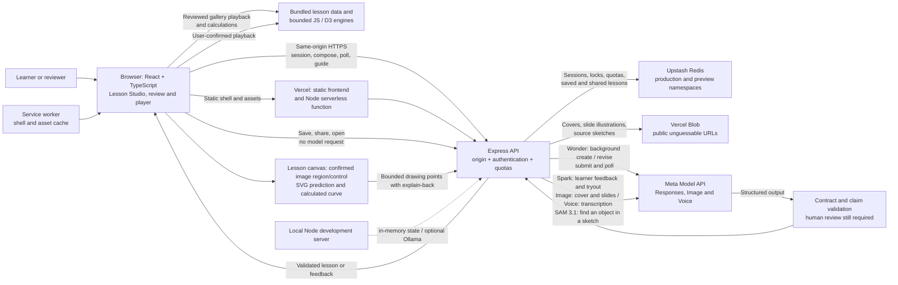

# ExplainBack architecture and technology stack

This document describes the standalone `explainbackapp` repository. Update the diagram and stack table in the same change whenever components, integrations, storage, deployment paths, or model responsibilities change. Verify the implementation and deployment independently; this diagram is not a release-status record.

## Creation and learning flow

1. A reviewer enters via an access code or tester session. Public gallery lessons can play without sign-in or a model request.
2. The author explicitly asks for a lesson. In hosted Studio, Wonder can submit a background response; the browser polls the API while the page remains open. Spark handles learner feedback and the test-learner role. Other configured choices and synchronous paths remain available locally.
3. The server validates structured lesson data, including obvious question-shaped generated prediction claims, before returning it. The author reviews and can revise the assumptions, formulas and teaching text before presentation. Validation does not establish scientific correctness or guarantee that a statement is meaningful or testable.
4. The browser runs bounded model or process demonstrations and checks numeric transfers locally. Optional model feedback is a separate explicit request; the generated equations and authored explanations still need human review.
5. Background requests and responses, including attached images, are stored by Meta. The app stores temporary session state in Redis in the cloud; it does not resume background work after a page reload or navigation. Browser speech synthesis plays show narration; optional Meta Image draws show covers and, on request, one illustration per slide; optional Meta Voice transcribes the spoken explain-back. With Vercel Blob configured, drawn images and source sketches are stored as public, unguessable URLs and kept with saved lessons.
6. For an image-based numeric lesson, the creator can select a SAM suggestion, draw a region, or select the whole image with the keyboard, then explicitly connect it to an existing control. This optional chapter metadata requires renewed lesson review and stays with saved/exported/shared lessons. It does not infer physical measurements from image pixels. The learner can draw a predicted curve with a pointer or enter three points, reveal the existing model calculation, and submit their explanation and prediction together for feedback. [Lesson canvas](lesson-canvas.md) describes the boundaries and recovery behavior.

The public evaluation card is built from `docs/evaluation.md` and documents methods and limits. Dated evaluation reports and operational measurements are kept in the separate private repository and are not linked from the public app. Selected lesson fixtures remain public and reviewable.

## Create and Tryout workspace

The creator workspace separates navigation from the working lesson and its learner attempt. A persistent lesson header exposes Create / Tryout tabs, Create home, New lesson, and saving. Global Create explicitly opens the home form and its current-work resume card. Returning home does not clear the draft; starting or opening another lesson protects unsaved changes with save, discard and keep-editing choices. Failed saves or generation leave the current work intact. A successful new draft clears the prior saved ID so it cannot overwrite that lesson.

The editor and creator's player remain mounted while hidden. The player pauses animation, guided replay and microphone capture when hidden; switching areas sends no model or transcription request. The browser recovery record under `explainback-studio-draft` retains navigation, the original attempt lesson and engine state, transfer input/result, explanations, drawings, cached feedback, pending definition edits, and a saved-content fingerprint. Save and navigation changes persist immediately; typing is debounced and page exit flushes the latest record. Optional fields extend the version-1 record; legacy `presenting` migrates to the corresponding area. The saved lesson's server identity remains separate from local recovery, and a failed local write displays a save/export notice.

Changes to learner-facing content invalidate review and mark the prior attempt outdated. It remains available in recovery until the creator explicitly starts a new tryout after review. Title and display-unit changes preserve the attempt. Unapplied definition edits block save and tryout until applied or discarded. In-flight requests remain associated with their current working lesson; choosing to stop before moving on invalidates late replies. Ordinary area switching keeps the request active, with editors disabled during mutations. Public gallery and shared lessons retain their standalone player and existing access rules.

## Technology stack

| Layer | Technology and role | Source of truth |
| --- | --- | --- |
| Client | React 19, TypeScript, Vite; bilingual English / Simplified Chinese interface | `frontend/`, `package.json` |
| Appearance | Paper, Liquid Glass and Meta Blue with light/dark palettes; independent System (default), Light and Dark modes; semantic CSS colors and a bilingual preview-tile picker; browser-local preferences | `public/appearance.js`, `public/themes.css`, `frontend/appearance.css`, `frontend/components/Appearance.tsx` |
| Simulations and graphics | Plain ES modules, D3 scale/shape/selection; bounded expressions and predefined engines | `public/`, `frontend/components/ExperimentView.tsx` |
| Lesson canvas | SVG and Pointer Events; creator-confirmed image regions/control links, keyboard point entry, prediction overlay, shared bounded drawing validation and server-recomputed comparison values | `frontend/components/CanvasBindingEditor.tsx`, `frontend/components/PredictionCanvas.tsx`, `public/lesson-canvas.mjs` |
| Server | Node.js 26, Express 5; shared local and Vercel API handler | `src/server.mjs`, `api/index.js` |
| AI | Meta Muse Wonder, Spark, Image, Voice and SAM 3.1; OpenAI-compatible Responses SDK for text, direct Meta APIs for image, audio and segmentation; Muse Glimmer or a Muse Spark Open build through Ollama locally | `src/meta.mjs`, `src/llm/`, `src/cloud.mjs` |
| State and access | Upstash Redis REST in hosted environments; in-memory local adapter; reviewer codes, tester sessions and rate limits; saved lessons per creator with public share links | `src/redis-state.mjs`, `src/state.mjs`, `src/tester-auth.mjs`, `src/lessons.mjs`, `src/lesson-routes.mjs` |
| Studio image routes | SAM 3.1 detection, Muse Image illustration, and a library cover for a reviewed lesson drawn at a signed-in creator's request (kept in state, served to everyone by the public `/api/covers`), as one request each, sharing the action handler's session, budget and trace plumbing | `src/studio-images.mjs`, `src/lesson-covers.mjs`, `src/request-error.mjs` |
| Site frame | Header with Library, Create and About, one account control (Sign in, or the hourly budget pill with Sign out), a shared page header (crumb trail, one h1, meta line, actions) used by the lesson player, the narrated show, the comparison, the evaluation card, the About page, both benches and the Create home page, with a collapsible 6-step tour above the question form (finished steps checked, the current one solid, a hint on each bubble with its cost or a reminder to review the draft, the step cards in a disclosure, Run next and Run all for signed-in reviewers); the 1120 px content column shared by header, main and footer. On phones the header folds the navigation, language and account controls behind one Menu button, and a bench opened without preview access shows an inline locked stage with the access button and a link to the lesson version. The benches are listed in the library as coached lessons rather than in the header. The phone hero retains a compact introductory tour. Lesson transfer questions are separated from a collapsed reference to the earlier experiment; show playback controls precede the slide, and gallery shows reuse the page title. Comparisons use a compact summary and expandable details, with AI wording scores and the human science review requirement explicit | `frontend/App.tsx`, `frontend/components/PageHeader.tsx`, `frontend/components/About.tsx` |
| Studio ground route | Search first: Spark gathers a dated fact sheet for a topic with the Muse web search tool (one request), the author receives it as references and may name only its pages as the lesson's sources; the adapter harvests the pages each search returned and reads the last message as the structured reply. See [search-grounding.md](search-grounding.md) | `src/lesson-ground.mjs`, `src/meta.mjs`, `/api/studio/ground` |
| Studio compare route | One question drafted by Muse Wonder and Muse Spark at once, each reply checked by the evaluation's open-question scorer and the ready lessons scored by the rubric judge (the tester role, or the other compared model when the creator picks it), which may search the web and score factual currency when the creator asks; two to four requests on the same budget | `src/studio-compare.mjs`, `src/eval/studio.mjs`, `src/eval/judge.mjs` |
| Images | Vercel Blob keeps the bytes of show covers, slide illustrations and source sketches for saved lessons; records hold URLs only; without a token images stay in the browser | `src/blob.mjs`, `src/lessons.mjs`, `scripts/prune-blobs.mjs` |
| Delivery | Vercel static frontend and serverless function, Node 26, service worker and web manifest | `vercel.json`, `scripts/build-vercel.mjs`, `public/sw.js` |
| Optional local model | Ollama, guarded for sequential local use; not available through the cloud router | `src/llm/ollama*.mjs`, `src/cloud.mjs` |
| Verification | Node test runner, Vitest, React Testing Library, Playwright, TypeScript, Oxlint and Prettier | `package.json`, `test/`, `frontend/`, `e2e/` |

For exact installed versions, use `package-lock.json`. Keep credentials out of documentation; see `docs/repo-guidelines.md` for what stays out of this public repository.

## Appearance and browser preferences

The Appearance control is part of the shared header and is available inside the Menu on phones. Its native radio groups independently select a mode (System, Light or Dark) and a theme family (Paper, Liquid Glass or Meta Blue), with previews in the resolved light/dark palette. Selection does not remount the lesson, change the route, or make an API/model request. New visitors use Paper with System mode, following `prefers-color-scheme` immediately and when the device changes. Manual Light or Dark overrides the device until System is selected again.

Theme, mode and the explicit Liquid Glass reduced-transparency preference are stored under `explainback-appearance` in local storage. Legacy Midnight Paper migrates to Paper + Dark, keeping the same palette; legacy Paper, Glass and Meta choices retain their light appearance. Missing or malformed preferences fall back to Paper + System. Blocked storage permits changes for the current page. Storage events update other open tabs, including a reset to defaults when the preference is removed or storage is cleared. The preference is not stored with a lesson or synchronized through an account.

`index.html` loads the small, idempotent `public/appearance.js` classic script synchronously before the app. It validates and migrates the saved value, resolves mode, and sets root theme/mode/scheme attributes, native control color scheme, initial canvas color and browser theme color before React starts. React subscribes to its stable snapshot through `useSyncExternalStore`; the same script is bundled with the picker as a fallback. `public/themes.css` supplies the palettes; the existing styles retain their light Paper color fallbacks. Chart SVG attributes resolve CSS variables at paint time, so changing appearance does not restart a simulation. Illustrations and image bytes are unchanged.

Liquid Glass uses translucent material on the header and controls, with opaque reading and input surfaces in both modes. It falls back to matching opaque controls when backdrop filtering is unavailable, when the user chooses Reduce transparency, or when the browser reports a system reduced-transparency preference. Reduced motion and forced colors are respected, and print styles use a light palette. These web materials are a visual interpretation; no native Apple rendering framework or Meta UI integration is added. All themes retain the same human review requirements for lessons and model feedback.

`src/static.mjs` allowlists the startup script and palette CSS for local serving and copying by `scripts/build-vercel.mjs`. Their versioned head URLs are also precached in the service-worker shell, preventing an older worker from serving an incompatible appearance runtime. The shell cache retains existing hashed app assets during an update so they remain available offline.

## Meta models and where each one works

| Model (dev.meta.ai) | Role in ExplainBack | Where |
|---|---|---|
| Muse Wonder | Drafts and revises lessons, in the background when a sketch is attached; drafts alongside Spark when a creator compares, and judges both drafts when picked as the judge | `src/lesson-author.mjs`, `/api/studio/compose`, `/api/studio/compare` |
| Muse Spark 1.3 | Plays the first-time learner (tryout), grades explain-backs, writes the narrated show script; drafts alongside Wonder and, unless the creator picks Wonder, judges both drafts when a creator compares; the hosted default | `src/lesson-tester.mjs`, `src/lesson-show.mjs`, `src/studio-compare.mjs` |
| Muse Image | Draws the show cover, the slides the show writer flags (up to two, within the request budget) and, on request, any other slide | `/api/studio/show`, `/api/studio/illustrate` |
| Muse Voice Transcribe | Transcribes the spoken explain-back | `/api/studio/transcribe` |
| SAM 3.1 | Finds the one thing a creator names in their sketch or photo; boxes appear in Spotlight and as selectable suggestions in the canvas editor. The creator confirms which region represents which control | `/api/studio/detect`, `frontend/components/Spotlight.tsx`, `frontend/components/CanvasBindingEditor.tsx` |
| Muse Glimmer | Local creator model through Ollama (not on Vercel) | `EXPLAINBACK_OLLAMA_MODELS` |
| Muse Spark Open | Open weights; any self-hosted build runs through the same Ollama option | `EXPLAINBACK_OLLAMA_MODELS` |
| Muse Code | A development product, not an API; not part of the app | — |

## Access limits

- Failed sign-ins are counted per visitor address with a shared backstop across all visitors, checked before the credentials. On Vercel the visitor address is the platform's `x-real-ip` header (`vercelClientAddress` in `src/cloud.mjs`); locally it is the socket peer. The limits are defined in `src/tester-auth.mjs`.
- Access-code and tester sessions have separate concurrency limits and expire. Signing in again from the same browser replaces that browser's earlier session rather than taking another slot; see `src/tester-auth.mjs` for the constants and lifetime handling.
- Access-code labels identify both the hourly action-budget bucket and the saved-lesson owner. Everyone signed in under the same label can see, edit, share and delete that label's saved lessons. Separate labels provide separate budgets and shelves; rotating the code value while retaining its label preserves both the shelf and the current budget counter. Publicly shared lessons remain available after the owner's code is revoked.
- The hourly budget uses a fixed window starting with the first counted action, rather than a sliding hour or a clock-hour reset. The configured quota is an application action limit, not a provider-call or monetary cap: for example, one show action can generate text, a cover and slide images, and text requests may retry. Gallery playback, saving lessons and status checks do not consume this budget.
- Codes expire at the end of their configured UTC date. Removing or rotating a code invalidates its existing sign-ins on their next authenticated request. Existing sessions retain their issued quota and cannot outlive their original expiry; changing the configured quota or extending the expiry requires signing in again. A shortened configured expiry also invalidates existing sign-ins once that date passes.
- Update the complete access-code variable in the intended Vercel environment and create a new deployment to activate it; existing deployments retain their configuration. Configure Production and Preview with separate access-code secrets so updating one environment does not change the other's configured access. Validate every entry before updating because malformed or expired entries are skipped with positional warnings. Keep labels, quota plans and distribution records in private notes; code values and live invite links stay out of Git, as described in `docs/repo-guidelines.md`.

## Multi-turn and prompt caching

- **Chained turns.** Within one Studio session, each Meta text turn chains onto the session's last stored response from the *same model in the same role* with `previous_response_id`: author turns (compose → revise → show) and learner turns (tryout → explain-back guide) form separate chains, so the test learner never inherits the author's conversation even when both roles run on the same model. The model keeps its reasoning context across its own turns; the request still carries the checked lesson, so a stale chain can never override the validated state. Turns are therefore stored on Meta's side (`store: true`) for the studio text calls; image, voice and segmentation calls are not stored. If an earlier response has expired (400/404), the chain is dropped and the turn runs once unchained. Ollama turns never chain. A turn can only chain onto a structured-output reply, not onto an unanswered function call (the API returns 400 for that), so every Studio text request uses structured output.
- **Reasoning summaries.** Every Meta text turn asks for a short summary of the model's private reasoning (`reasoning.summary: "auto"`). When the model gives one it is shown under the request summary as "The model's own account of its reasoning, unverified", and recorded in the trace. It is the model describing itself, not evidence that the lesson is right; it is often empty, and it arrives in the model's own words, usually English, whatever the interface language.
- **Reasoning effort per step.** The learner turns (tryout and explain-back guide) use `minimal`; the author turns (compose, revise, show) use `low`, as defined in `src/reasoning-effort.mjs`. Reasoning tokens count against the output budget and can add latency before the first byte. The effort used is reported in each reply's metrics (`effort`). These settings do not guarantee lesson quality or latency; measured comparisons belong in private evaluation notes. No step requests `none`.
- **Prompt caching.** Instructions come first and the lesson last, so the stable prefix is as long as possible; each mode sends a stable `prompt_cache_key` (`explainback-compose`, `-guide`, `-tryout`, `-show`) so requests that share a prefix route to the backend holding it. Responses report `usage.cached` (input tokens served from cache), shown in the request summary as "from cache" and in the provider console.
