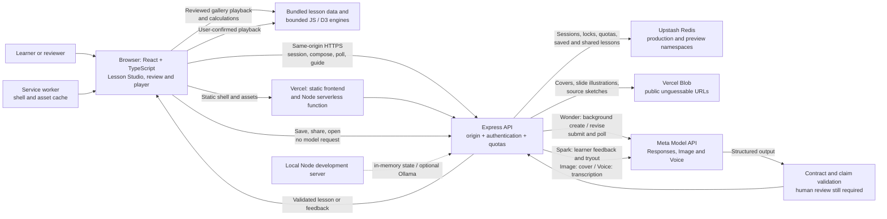

# ExplainBack architecture and technology stack

This document describes the standalone `explainbackapp` repository. Update the diagram and stack table in the same change whenever components, integrations, storage, deployment paths, or model responsibilities change. Verify the implementation and deployment independently; this diagram is not a release-status record.

## Creation and learning flow

1. A reviewer enters via an access code or tester session. Public gallery lessons can play without sign-in or a model request.
2. The author explicitly asks for a lesson. In hosted Studio, Wonder can submit a background response; the browser polls the API while the page remains open. Spark handles learner feedback and the test-learner role. Other configured choices and synchronous paths remain available locally.
3. The server validates structured lesson data, including obvious question-shaped generated prediction claims, before returning it. The author reviews and can revise the assumptions, formulas and teaching text before presentation. Validation does not establish scientific correctness or guarantee that a statement is meaningful or testable.
4. The browser runs bounded model or process demonstrations and checks numeric transfers locally. Optional model feedback is a separate explicit request; the generated equations and authored explanations still need human review.
5. Background requests and responses, including attached images, are stored by Meta. The app stores temporary session state in Redis in the cloud; it does not resume background work after a page reload or navigation. Browser speech synthesis plays show narration; optional Meta Image draws show covers and, on request, one illustration per slide; optional Meta Voice transcribes the spoken explain-back. With Vercel Blob configured, drawn images and source sketches are stored as public, unguessable URLs and kept with saved lessons.

## Technology stack

| Layer | Technology and role | Source of truth |
| --- | --- | --- |
| Client | React 19, TypeScript, Vite; bilingual English / Simplified Chinese interface | `frontend/`, `package.json` |
| Simulations and graphics | Plain ES modules, D3 scale/shape/selection; bounded expressions and predefined engines | `public/`, `frontend/components/ExperimentView.tsx` |
| Server | Node.js 22, Express 5; shared local and Vercel API handler | `src/server.mjs`, `api/index.js` |
| AI | Meta Muse Wonder, Spark, Image and Voice; OpenAI-compatible Responses SDK for text, direct Meta APIs for image and audio | `src/meta.mjs`, `src/llm/`, `src/cloud.mjs` |
| State and access | Upstash Redis REST in hosted environments; in-memory local adapter; reviewer codes, tester sessions and rate limits; saved lessons per creator with public share links | `src/redis-state.mjs`, `src/state.mjs`, `src/tester-auth.mjs`, `src/lessons.mjs` |
| Images | Vercel Blob keeps the bytes of show covers, slide illustrations and source sketches for saved lessons; records hold URLs only; without a token images stay in the browser | `src/blob.mjs`, `src/lessons.mjs`, `scripts/prune-blobs.mjs` |
| Delivery | Vercel static frontend and serverless function, Node 22, service worker and web manifest | `vercel.json`, `scripts/build-vercel.mjs`, `public/sw.js` |
| Optional local model | Ollama, guarded for sequential local use; not available through the cloud router | `src/llm/ollama*.mjs`, `src/cloud.mjs` |
| Verification | Node test runner, Vitest, React Testing Library, Playwright, TypeScript, Oxlint and Prettier | `package.json`, `test/`, `frontend/`, `e2e/` |

For exact installed versions, use `package-lock.json`. Keep credentials out of documentation and the shared progress ledger.
